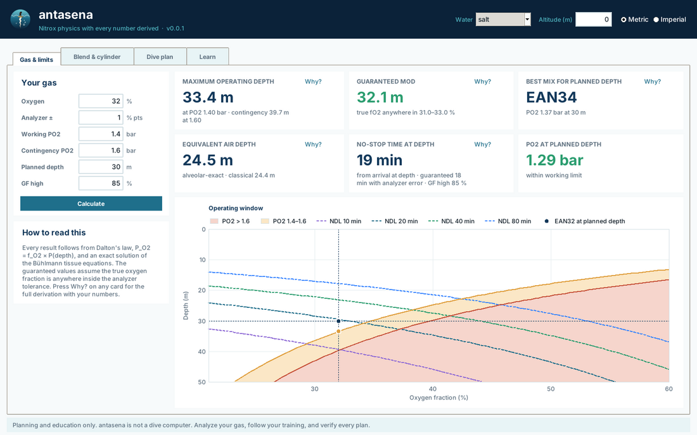
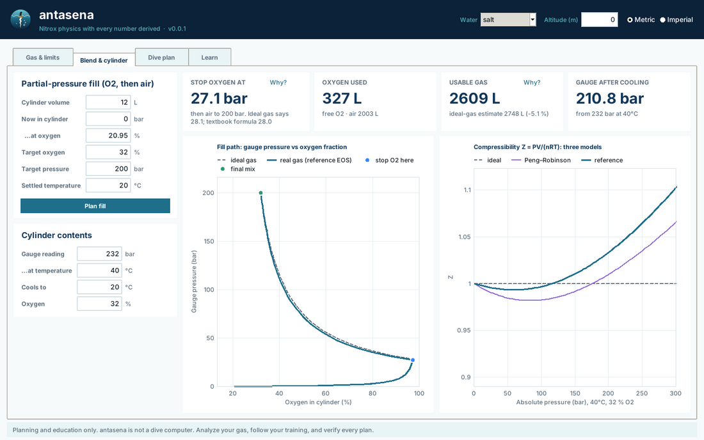
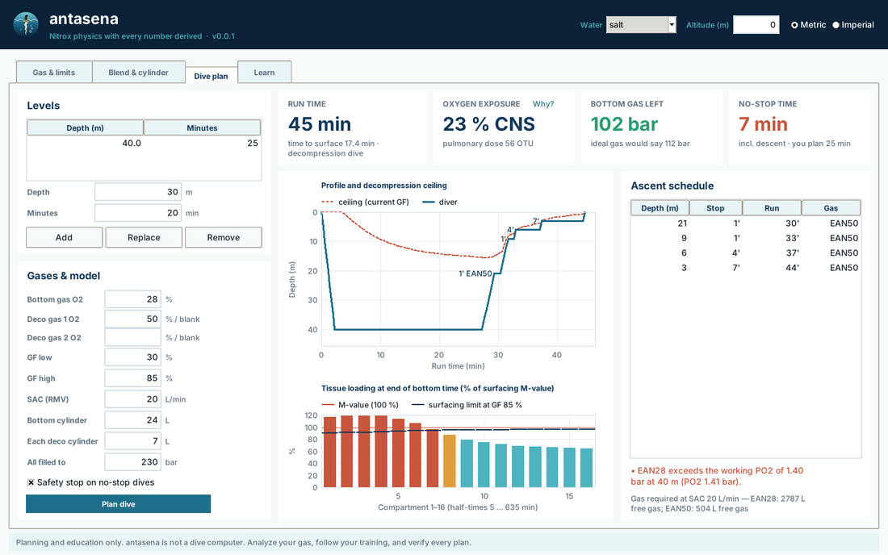

<p align="center"></p>

<h1 align="center">antasena</h1>

**Rigorous, educational nitrox diving calculations and a desktop app in pure Python.**

[](https://doi.org/10.5281/zenodo.23410341)
[](https://github.com/sandyherho/antasena)
[](https://pypi.org/project/antasena/)
[](https://www.python.org/)
[-2a9d6f)](https://docs.python.org/3/library/)
[](https://docs.python.org/3/library/tkinter.html)
[](LICENSE)
[](https://antasena.readthedocs.io)
[](https://pytest.org)
[](https://hypothesis.readthedocs.io)
[](https://www.sphinx-doc.org)
[](https://myst-parser.readthedocs.io)
[](https://www.mathjax.org)
[](http://www.coolprop.org)
[](https://pyinstaller.org)
[](https://github.com/sandyherho/antasena)

antasena computes what a nitrox diver and a gas blender need (MOD, best mix, equivalent air depth, no-decompression limits, gradient-factor decompression schedules, oxygen toxicity, real-gas blending and cylinder contents) and shows *how* every number is obtained. Each result has a **Why?** button that prints the governing equation, every intermediate value with your numbers substituted, the assumptions, and the validity range.

The library has **zero runtime dependencies**: the standard library only, including the Tkinter app.

Named after Antasena, the son of Bima in Javanese wayang, who lives in the depths of the ocean and breathes underwater. The logo pairs the sea with a keris whose blade carries seven *luk* (bends).

> **Safety.** antasena is a planning and teaching tool. It is not a dive computer, it has not been certified, and it does not replace training, an analyzed gas label, or your own judgment. Verify every plan.



## What makes it rigorous

| Quantity | How antasena computes it |
|---|---|
| Tissue tensions | Exact Schreiner solution of the linear tissue ODE on every segment, written in a cancellation-free form (`expm1` plus a series); checked against 50-digit arithmetic. No time stepping. |
| No-decompression limit | Closed form, `t = ln[(P_alv - P0)/(P_alv - M)]/k`, minimized over the 16 ZH-L16C compartments; checked against brute-force bisection. |
| Decompression | ZH-L16C with gradient factors and gas switches; the test suite verifies that the diver is never shallower than the ceiling at the GF in force. |
| CNS and OTU | Closed-form integrals of the NOAA limits and the OTU dose law over linear PO2 ramps; checked against piecewise quadrature. |
| Equivalent air depth | Classical form **and** an alveolar-exact form that makes a nitrox dive tissue-for-tissue identical to an air dive (a theorem the tests verify to 1e-12). |
| Gas thermodynamics | Reference-quality compressibility factor Z(T, P, x) from the multiparameter Helmholtz mixture model, tabulated and interpolated in pure Python (max error 1.5e-6), plus Peng–Robinson as a transparent textbook model. |
| Blending | Exact mole balance (a 2×2 linear system on the composition simplex); pressures enter only through the EOS. Gauge and absolute pressure are kept distinct. |
| Uncertainty | Guaranteed MOD and NDL under O2-analyzer and depth-gauge error, using proven monotonicity; property tests check the bounds enclose sampled truth. |

## A few numbers worth knowing

From `python tools/validation_report.py`:

* **Gas content.** A 12 L cylinder of air at 232 bar holds about **2615 L** of usable gas at 20 °C, not the 2748 L that `P × V` suggests (−4.8 %). At 300 bar the shortfall is −9.8 %.
* **Blending.** For EAN32 to 200 bar from empty, real-gas thermodynamics puts the O2 stop at **27.1 bar**; the textbook formula says 28.0 bar. Following the textbook target gives about 32.3 % O2 instead of 32 %: a small, systematic bias that sits inside typical analyzer tolerance, which is one more reason to analyze every fill.
* **MOD conventions.** EAN32 at 1.4 bar: 33.44 m in sea water (1025 kg/m³), 33.61 m with the EN 13319 gauge density, 33.75 m with the rounded 10 m/bar rule. The app shows which convention it uses.
* **Pure O2 at 6 m.** In sea water at sea level, O2 at 6 m gives PO2 1.616 bar, above 1.6. With a strict 1.6 bar limit antasena therefore switches to O2 at 3 m, unless you choose the 10 m/bar convention.
* **Peng–Robinson.** The textbook cubic EOS underestimates Z by up to 3.7 % below 300 bar for O2/N2 mixtures, which is why it is offered for teaching, not as the default.

## Install

```bash
pip install antasena           
# or from source
git clone https://github.com/sandyherho/antasena && cd antasena && pip install .
```

`pipx install .` installs the app in its own environment. On Debian/Ubuntu the app needs Tk: `sudo apt install python3-tk` (Windows and macOS Python installers include it). The command line works without Tk.

Stand-alone executables for Windows, macOS and Linux are built by the `release` workflow with PyInstaller; they need no Python installation.

## Use

### Desktop app

```bash
antasena          # or: antasena-app, or: python -m antasena
```

Four tabs: **Gas & limits** (MOD, guaranteed MOD, best mix, EAD, NDL, operating-window chart with NDL contours), **Blend & cylinder** (fill plan, real vs ideal gas paths, Z for three models, hot-fill cooling), **Dive plan** (multilevel profile, deco schedule with gas switches, ceiling, tissue loading, CNS/OTU, gas and cylinder end pressure), **Learn** (live derivations). Metric and imperial units, salt/EN13319/fresh water, altitude.

| | |
|---|---|
|  |  |

### Command line

```bash
antasena mod 32 --analyzer 1          # MOD and guaranteed MOD
antasena bestmix 30
antasena ead 32 30 --why              # --why prints the derivation
antasena ndl 32 30 --gf-high 85
antasena blend 32 200 --start 50 --start-fo2 32
antasena cylinder 230 --temp 45 --cool-to 20
antasena plan 40:25 --gas 28 --deco 50 --gf 30 85
```

### Python

```python
from antasena import Nitrox, Environment, mod, plan_dive, Level, Tank, plan_partial_pressure

mod(Nitrox.ean(32), 1.4)                               # 33.44 m
r = plan_dive([Level(40, 25)], Nitrox.ean(28), [Nitrox.ean(50)],
              gf_low=0.30, gf_high=0.85,
              tanks=[Tank(Nitrox.ean(28), 24, 230), Tank(Nitrox.ean(50), 7, 200)])
for s in r.stops:
    print(s.depth, s.minutes, s.gas)
print(r.runtime, r.cns, r.otu, r.tank_report)

plan_partial_pressure(0.32, 200).fill_add_to           # 27.13 bar (gauge)
```

## Testing

```bash
pip install -e ".[test]"
pytest                                  # 100+ tests, property-based where possible
HYPOTHESIS_PROFILE=thorough pytest      # 10x more random cases
pip install CoolProp && pytest          # also re-checks the EOS table against CoolProp
```

What is tested, among others: Schreiner against RK4 and 50-digit arithmetic; the semigroup property of tissue exposure; closed-form NDL against bisection; the EAD-equivalence theorem; CNS/OTU against quadrature, additivity and time-reversal symmetry; mole and O2 conservation in blending for three EOS models; EOS inverse round trips and interpolation accuracy; that guaranteed bounds enclose sampled truth; that decompression schedules never violate the ceiling; that every derivation reproduces the library result; and the desktop app itself (under a virtual display in CI).

The table of ZH-L16C coefficients is checked against Bühlmann's generating formulas. The tabulated `b` for the 18.5-min compartment (0.7825) lies 0.0100 above its formula value; antasena keeps the published value and a test pins this deviation.

## Scope and limitations

* Nitrox only (O2/N2; argon lumped with nitrogen). No helium, no rebreathers.
* Bühlmann ZH-L16C is one decompression model among several; no model removes decompression risk.
* CNS accrual below 0.6 bar is not defined by the NOAA table; antasena follows Baker's method (900 min limit just above 0.5 bar). Plans above 1.6 bar are rejected.
* The EN 13319 density of 1020 kg/m³ is the value commonly cited by dive-computer makers; the standard's text itself was not checked.
* At altitude, tissues start saturated at the local surface pressure (an acclimatized diver).
* Fills are assumed isothermal at the settled temperature; use the cylinder tool for hot gauges.
* The EOS table covers −20 to 80 °C and 0 to 400 bar.

## Documentation

Full documentation (installation, app guide, command line, theory, equation reference, validation, API) is built with Sphinx for Read the Docs from the `docs/` folder: `pip install -r docs/requirements.txt && sphinx-build -b html docs docs/_build/html`.

* [`docs/theory.md`](docs/theory.md): derivations of every equation used.
* [`docs/equations.md`](docs/equations.md): every equation in one table.
* `tools/generate_z_table.py`: regenerates the EOS table (needs CoolProp).
* `tools/validation_report.py`: reproduces the numbers above.
* `tools/independent_check.py`: recomputes MOD, EAD, NDL, full plans (1-s RK4 replay with a ceiling check every second), CNS (Baker's coefficient table), OTU, gas use, blending and cylinder contents (CoolProp called directly) without reusing antasena's mathematics.

## Authors

Sandy H. S. Herho, Faruq Khadami, Iwan P. Anwar, Karina A. Sujatmiko, Sito F. Biosa, Alfita P. Handayani, Dasapta E. Irawan

## Citing

See [`CITATION.cff`](CITATION.cff).

## References

* Peng, D.-Y., Robinson, D. B. (1976). A new two-constant equation of state. *Ind. Eng. Chem. Fundam.* 15(1), 59–64. https://doi.org/10.1021/i160057a011
* Lemmon, E. W., Jacobsen, R. T., Penoncello, S. G., Friend, D. G. (2000). Thermodynamic properties of air and mixtures of nitrogen, argon, and oxygen from 60 to 2000 K at pressures to 2000 MPa. *J. Phys. Chem. Ref. Data* 29(3), 331–385. https://doi.org/10.1063/1.1285884
* Span, R., Lemmon, E. W., Jacobsen, R. T., Wagner, W., Yokozeki, A. (2000). A reference equation of state for the thermodynamic properties of nitrogen. *J. Phys. Chem. Ref. Data* 29(6), 1361–1433. https://doi.org/10.1063/1.1349047
* Schmidt, R., Wagner, W. (1985). A new form of the equation of state for pure substances and its application to oxygen. *Fluid Phase Equilib.* 19(3), 175–200. https://doi.org/10.1016/0378-3812(85)87016-3
* Kunz, O., Wagner, W. (2012). The GERG-2008 wide-range equation of state for natural gases and other mixtures. *J. Chem. Eng. Data* 57(11), 3032–3091. https://doi.org/10.1021/je300655b
* Bell, I. H., Wronski, J., Quoilin, S., Lemort, V. (2014). Pure and pseudo-pure fluid thermophysical property evaluation and the open-source thermophysical property library CoolProp. *Ind. Eng. Chem. Res.* 53(6), 2498–2508. https://doi.org/10.1021/ie4033999
* Bühlmann, A. A. *Tauchmedizin* (Springer; several editions) and *Decompression–Decompression Sickness* (Springer, 1984): ZH-L16 coefficients.
* Schreiner, H. R., Kelley, P. L. (1971). A pragmatic view of decompression. In *Underwater Physiology IV* (Lambertsen, ed.), Academic Press.
* NOAA Diving Manual (oxygen exposure limits). 

## License

MIT. Copyright © 2026 Bandung Institute of Technology.
